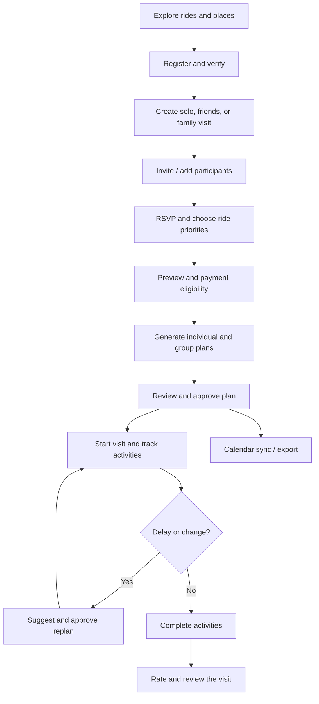
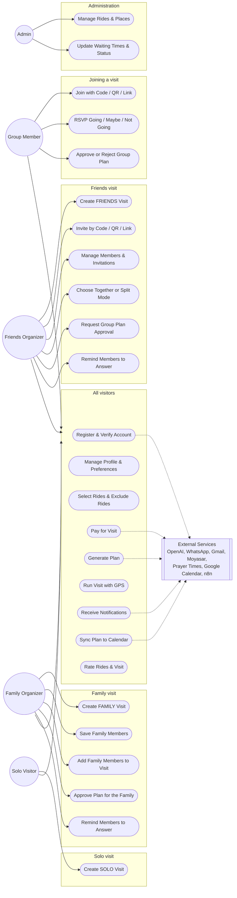
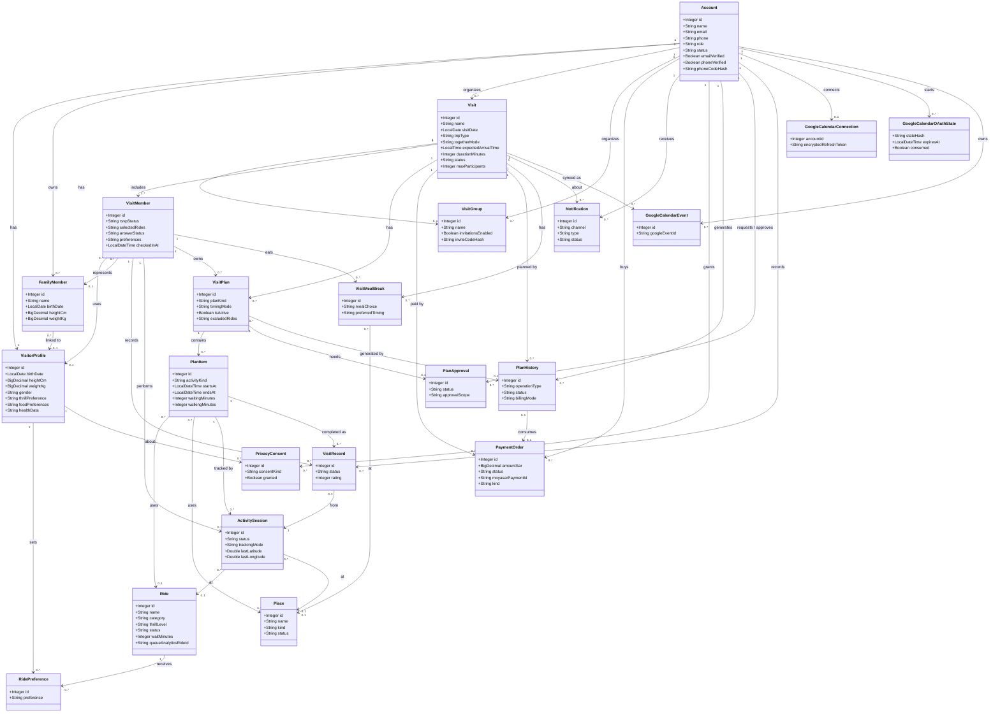
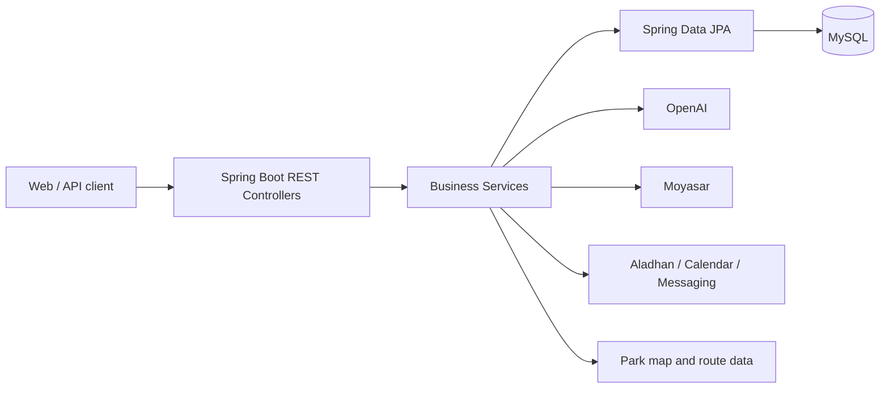
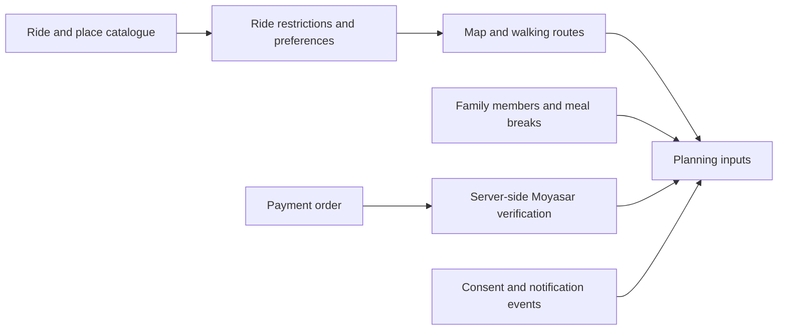

[README_Nawaf.md](https://github.com/user-attachments/files/34115950/README_Nawaf.md)
<div align="center">


# SIKKA | سكة 🎢

### Your Qiddiya day, planned in minutes.

**An AI-powered visit planner for Six Flags Qiddiya — built for solo visitors, friends, and families.**

[](https://www.java.com/)
[](https://spring.io/projects/spring-boot)
[](https://www.mysql.com/)
[](https://railway.com/)

[Overview](#overview) · [Features](#features) · [User Journey](#user-journey) · [Architecture](#architecture) · [API Overview](#api-overview) · [Live Website](https://sikka.up.railway.app/#home) · [API Documentation](docs/API-DOCUMENTATION.md) · [Contributions](#nawaf-alghamdi-contributions)

</div>

---

## Overview

**SIKKA (سكة)** helps visitors organize a full day at **Six Flags Qiddiya**. Instead of managing ride choices, queue times, walking distances, meals, and group decisions in separate places, Sikka brings them together in a coordinated visit plan.

The organizer creates a visit; friends or family participate and select rides; the backend checks ride restrictions; AI assists with individual and group itineraries; and the app supports approvals, progress tracking, GPS-assisted activities, alerts, and post-visit ratings.

> **Scope:** Sikka plans park visits. It does **not** sell Six Flags admission tickets. Paid functionality refers to Sikka's planning service.

## The Problem & Our Solution

| Visitor challenge | Sikka's approach |
|---|---|
| Different interests and ride restrictions | Personal profiles, ride priorities, and eligibility checks |
| Difficult group coordination | Solo, friends, and family visits; invitations and participant management |
| Time lost to queues and walking | Itineraries informed by available waiting-time and map data |
| Meal and prayer breaks are overlooked | Scheduled dining breaks and prayer times |
| Schedules become outdated during the visit | Completion tracking, delays, and proposed replanning |
| Hard to recall what was completed | Per-member records, ratings, and progress summaries |

## Technology Stack

| Layer | Technologies / integrations |
|---|---|
| Backend | Java 17, Spring Boot 4.1.1, REST controllers |
| Persistence | MySQL 8, Spring Data JPA / Hibernate |
| Authentication | Spring Security, session authentication, BCrypt |
| AI planning | OpenAI API, server-side itinerary validation |
| Park data & maps | Ride / place catalogue, park map and walking routes |
| Prayer times | Aladhan API |
| Payments | Moyasar sandbox, backend-side payment verification |
| Communication | Gmail SMTP, UltraMsg WhatsApp, n8n webhooks |
| Calendar | Google Calendar OAuth, manual Google link, Apple `.ics` export |
| QR invitations | ZXing |
| Frontend (separate repository) | Next.js 16, React 19, TypeScript, Tailwind CSS |
| Testing & delivery | JUnit, Mockito, Maven Wrapper, Docker, GitHub Actions, Railway |

**Repository scope:** This repository contains the Spring Boot backend. Do not assume a React frontend is included in this repository or that every external integration is live in production.

## External APIs & Integrations

| Service | Purpose | Implementation area |
|---|---|---|
| OpenAI API | AI-assisted individual/group plans and replanning | Planning services |
| Aladhan API | Prayer time lookup for scheduling | `PrayerTimeService` |
| Google Calendar API | OAuth connection and synchronization of approved plans | Calendar services |
| Gmail SMTP | Email verification and account messages | Email services |
| UltraMsg (WhatsApp) | Phone verification and messages | WhatsApp services |
| Moyasar API | Server-side payment confirmation | `MoyasarService` |
| n8n webhooks | Workflow-driven notification delivery | `N8nNotificationService` |

Apple Calendar `.ics` exports, ZXing QR generation, browser GPS and local park routing are **not separate external REST API providers**. Provider setup and actual live delivery depend on credentials and deployment configuration.

## Features

### Accounts, profiles and group visits
- Account registration, email and optional phone verification, password recovery, authenticated profile management.
- Visit types: `SOLO`, `FRIENDS`, and `FAMILY`.
- Invitations through a code, QR code, or shareable link; RSVP and selected ride priorities.
- Family member profiles managed by the visit organizer.
- Free-visit allowance and server-verified payment for additional planning.

### AI-assisted planning
- Individual and coordinated group itineraries.
- Three ride priorities: `MUST_RIDE`, `PREFERRED`, `OPTIONAL`.
- Eligibility and itinerary constraints evaluated by the backend — AI output is not a substitute for official ride safety rules.
- Ride availability, waiting times, walking routes, meals, snacks, and prayer-time considerations.
- Plan approval, subgroup coordination, meeting points, and proposed replanning.

### During and after the visit
- Activity sessions started manually or through GPS-assisted flows.
- Family activity completion and per-member visit records.
- Delay notifications, current / next activities, and visit progress.
- Optional ratings and reviews for completed experiences.
- Calendar synchronization and export.

## User Journey


## Use Case Diagram

Sikka has three visit types, so the actors are separated by the type of visit they run.



| Actor | Visit type | What is different |
|---|---|---|
| **Solo Visitor** | SOLO | No group and no invitations; one individual plan |
| **Family Organizer** | FAMILY | Adds saved family members (children and adults) to the visit, chooses the rides for the family, reminds members to answer, and approves the plan for them |
| **Friends Organizer** | FRIENDS | Creates the group, invites by code / QR / link, chooses together or split mode, reminds members to answer, requests group approval |
| **Group Member** | FRIENDS / FAMILY | Joins an existing visit, answers RSVP, selects rides, approves or rejects plans |
| **Admin** | None | Manages the ride and place catalogue |

---

## Class Diagram

The diagram shows the **22 entities** of Sikka (key fields only) and their relationships, taken from the JPA mappings in the `Model/` package.



---

## Architecture



The Java code follows the project structure:

```text
src/main/java/com/example/sikka/
├── Advice/       # Exception handling
├── Api/          # Common API response / exception
├── Config/       # Security and configuration
├── Controller/   # REST endpoints
├── DtoIn/        # Request DTOs
├── DtoOut/       # Response DTOs
├── Model/        # JPA entities
├── Repository/   # Database access
└── Service/      # Business logic and integrations
```

## API Overview

The backend currently declares **170 REST endpoints across 22 controllers** on the GitHub `main` branch (28 October 2026). These are source-code route counts, not a claim that every external integration has passed live end-to-end testing.

**Contribution accounting:** Each Model belongs to its original Git creator. Each API endpoint is credited to the developer who first implemented that route, even when it appears in another team member's Controller. Subsequent shared fixes and integrations are listed separately; contributor-specific endpoint totals will be published only after the route-level Git audit is complete.

**Full API reference:** [API Documentation — 170 routes across 22 controllers](docs/API-DOCUMENTATION.md).

**Project links:** [SIKKA website](https://sikka.up.railway.app/#home) · [Backend (SIKKA-final)](https://github.com/Abdulaziz-Shafae/SIKKA-final).


## Data Model

The project currently contains **22 JPA models** across the following areas.

The project contains core models for visitors, visits, plans, park facilities, payments, messaging, and calendar sync. Examples include:

| Domain | Models |
|---|---|
| Users & visits | `Account`, `VisitorProfile`, `FamilyMember`, `Visit`, `VisitGroup`, `VisitMember` |
| Planning | `VisitPlan`, `PlanItem`, `PlanApproval`, `PlanHistory`, `VisitMealBreak` |
| Live execution | `ActivitySession`, `VisitRecord`, `Notification` |
| Park & billing | `Ride`, `Place`, `RidePreference`, `PaymentOrder`, `PrivacyConsent` |
| Calendar integration | `GoogleCalendarConnection`, `GoogleCalendarEvent`, `GoogleCalendarOAuthState` |

The current model inventory extends beyond the original **15-model team allocation**. Always use the `Model/` package for the current entity inventory rather than relying on the older ERD alone.


## Nawaf Alghamdi Contributions

**Core entities:** Ride, RidePreference, Place, PaymentOrder, PrivacyConsent, FamilyMember, VisitMealBreak.

**Main work:** ride and place catalogue, park geometry and map routes, ride filtering and eligibility data, family member persistence, meal-break records and preferences, consent management, and payment-order operations.

**Integrations:** park route data and walking estimates, Moyasar payment records/verification workflows, and notification delivery through n8n webhooks.

**Notification work:** original Git commits introduced `N8nNotificationService`, `NotificationEventService`, and `NotificationReminderService`; other team members also integrated notifications with visit and planning flows.

**Additional contributions:** map/facility data integration, shared family and meal planning workflows, and authorization updates to park-related routes. Mohammed contributed later payment implementation; shared work remains acknowledged separately.

---

## Flow 3: Park Data, Map & Payments (Nawaf Alghamdi)

**Personal contribution accounting:** Only endpoints first introduced by this contributor in Git count toward their individual total, regardless of controller or model ownership. The tables below document related API routes and do **not** claim all were authored by this contributor. A fully verified personal total is intentionally not published until route-by-route Git attribution is complete.

### 1. Flow Brief

Flow 3 supplies the park catalogue and walking/map context needed for planning, maintains visitor ride preferences and privacy consent, supports reusable family members and meal breaks, and records/payment verification steps for paid planning.



### 2. Models and Relationships

| Model | Purpose | Key relationships |
|---|---|---|
| `Ride` | Ride metadata, status and eligibility attributes | Referenced by plan items, records and preferences |
| `RidePreference` | Per-visitor ride preference | Belongs to `VisitorProfile` and `Ride` |
| `Place` | Park facilities and dining/meeting places | Referenced by plan items and meal breaks |
| `PaymentOrder` | Payment attempts and confirmation state | Associated with `Visit` and buyer `Account` |
| `PrivacyConsent` | Consent status and revocation | Associated with account and visitor profile |
| `FamilyMember` | Reusable family profiles | Owned by an account; can be linked to visit participants |
| `VisitMealBreak` | Meal/snack preferences and shared breaks | Associated with visit/members and optionally places |

**Map routing:** `MapController` exposes park geometry and walking route operations but does not have a separate `Map` JPA Model. Its controller-domain assignment follows Nawaf's park-map work.

**Cross-module dependencies:** Visit generation and live execution consume park/family/meal data. The payment service includes subsequent contributions by Mohammed; this README does not reassign those changes to Nawaf.

**Business rules**

- Ride eligibility is checked on known profile/restriction data; missing safety data must not be presented as verified eligibility.
- Map routing provides estimated walking context for planning; it should not present unsupported straight lines as real paths.
- Wait-time data should distinguish observations from fallback/default estimates.
- Payment confirmation is checked server-side; the frontend's callback alone is not treated as payment proof.
- Family and meal records are reused by visits and scheduling; edits must respect visit/member authorization.

### 3. Related Controller Routes

The following inventory documents Controllers grouped with Nawaf's Models and map ownership. It is **not yet the proposed standalone API Documentation** containing DTO schemas, parameter contracts, auth rules and examples.

**RideController — 12 routes**

| Method | Endpoint | Purpose |
|---|---|---|
| GET | `/api/v1/ride/get` | All rides |
| GET | `/api/v1/ride/get/{rideId}` | Ride details |
| POST | `/api/v1/ride/add` | Add ride |
| PUT | `/api/v1/ride/update/{rideId}` | Update ride |
| DELETE | `/api/v1/ride/delete/{rideId}` | Delete ride |
| GET | `/api/v1/ride/catalog` | Public ride catalogue |
| GET | `/api/v1/ride/available` | Available rides |
| GET | `/api/v1/ride/wait-times` | Ride wait times |
| GET | `/api/v1/ride/filter` | Filtered rides |
| PUT | `/api/v1/ride/admin/update-wait/{rideId}` | Update wait data |
| PUT | `/api/v1/ride/admin/update-status/{rideId}` | Update ride status |
| GET | `/api/v1/ride/eligibility/{memberId}/{rideId}` | Member ride eligibility |

**RidePreferenceController — 5 routes**

| Method | Endpoint | Purpose |
|---|---|---|
| GET | `/api/v1/ride-preference/get/my/preferences` | Ride preferences |
| GET | `/api/v1/ride-preference/get/details/{preferenceId}` | Preference details |
| POST | `/api/v1/ride-preference/add/{rideId}` | Create ride preference |
| PUT | `/api/v1/ride-preference/update/{preferenceId}` | Update preference |
| DELETE | `/api/v1/ride-preference/delete/{preferenceId}` | Delete preference |

**PlaceController — 6 routes**

| Method | Endpoint | Purpose |
|---|---|---|
| GET | `/api/v1/place/get` | All places |
| GET | `/api/v1/place/get/{placeId}` | Place details |
| POST | `/api/v1/place/add` | Add place |
| PUT | `/api/v1/place/update/{placeId}` | Update place |
| DELETE | `/api/v1/place/delete/{placeId}` | Delete place |
| GET | `/api/v1/place/by-kind` | Filter by place kind |

**PaymentOrderController — 5 routes**

| Method | Endpoint | Purpose |
|---|---|---|
| GET | `/api/v1/payment-order/get/my/orders` | My payment orders |
| GET | `/api/v1/payment-order/get/details/{paymentOrderId}` | Order details |
| GET | `/api/v1/payment-order/get/visit/{visitId}` | Visit payments |
| POST | `/api/v1/payment-order/add/{visitId}` | Create payment order |
| POST | `/api/v1/payment-order/confirm/{paymentOrderId}` | Confirm payment with provider |

**PrivacyConsentController — 4 routes**

| Method | Endpoint | Purpose |
|---|---|---|
| GET | `/api/v1/privacy-consent/get/my/consents` | My consents |
| GET | `/api/v1/privacy-consent/get/details/{consentId}` | Consent details |
| POST | `/api/v1/privacy-consent/add` | Grant consent |
| PUT | `/api/v1/privacy-consent/revoke/{consentId}` | Revoke consent |

**MapController — 8 routes**

| Method | Endpoint | Purpose |
|---|---|---|
| GET | `/api/v1/map/get/rides` | Rides map |
| PUT | `/api/v1/map/link/ride/{rideId}` | Link ride position |
| POST | `/api/v1/map/import/rides` | Import ride map data |
| POST | `/api/v1/map/import/places` | Import place map data |
| GET | `/api/v1/map/get/places` | Places map |
| GET | `/api/v1/map/route/{fromType}/{fromId}/{toType}/{toId}` | Walking route |
| GET | `/api/v1/map/get/data` | Map data |
| GET | `/api/v1/map/get/walking-context` | Walking route context |

**FamilyMemberController — 5 routes**

| Method | Endpoint | Purpose |
|---|---|---|
| GET | `/api/v1/family-member/get/my` | Saved family members |
| GET | `/api/v1/family-member/get/details/{familyMemberId}` | Family member details |
| POST | `/api/v1/family-member/add` | Add saved family member |
| PUT | `/api/v1/family-member/update/{familyMemberId}` | Update family member |
| DELETE | `/api/v1/family-member/delete/{familyMemberId}` | Delete family member |

**VisitMealBreakController — 10 routes**

| Method | Endpoint | Purpose |
|---|---|---|
| GET | `/api/v1/visit-meal-break/get/visit/{visitId}` | Visit meal breaks |
| POST | `/api/v1/visit-meal-break/add/{visitId}/{visitMemberId}` | Add meal break |
| PUT | `/api/v1/visit-meal-break/update/{visitId}/{mealBreakId}` | Update meal break |
| DELETE | `/api/v1/visit-meal-break/delete/{visitId}/{mealBreakId}` | Delete meal break |
| GET | `/api/v1/visit-meal-break/get/my/{visitId}` | Member meal breaks |
| POST | `/api/v1/visit-meal-break/add/shared/{visitId}` | Create shared break |
| DELETE | `/api/v1/visit-meal-break/delete/shared/{visitId}/{breakKey}` | Delete shared break |
| PUT | `/api/v1/visit-meal-break/update/shared/{visitId}/{breakKey}` | Update shared break |
| PUT | `/api/v1/visit-meal-break/preferences/{visitId}` | Update food preferences |
| PUT | `/api/v1/visit-meal-break/restaurant/{visitId}/{breakKey}` | Select restaurant |
### 4. External APIs and Technologies

| Service / technology | Purpose | Implementation |
|---|---|---|
| Moyasar API | Fetch provider payment and verify an order | `MoyasarService`, `PaymentOrderService` (shared with Mohammed) |
| n8n webhooks | Dispatch notification events to configured workflows | `N8nNotificationService` and event/reminder services |
| Park routing data | Ride/places locations and walking routes (local data, not external REST API) | `MapService` and route-data resources |
| Queue analytics | Queue data integration when configured; freshness must be checked | `QueueAnalyticsSyncService` |
| ZXing | QR generation used by visit invitations (shared integration) | `VisitGroupService` |

### 5. Tests and Validation

Park- and flow-related source tests include `ParkCatalogueValidationTest`, `QueueAnalyticsPlanningTest`, `RidePlanningDefaultsTest`, and `VisitPlanMapServiceTest`. These tests span multiple contributors; listing them here does not claim that Nawaf wrote every test or that the deployed environment passed them.

---

<div align="center">

**SIKKA | سكة** · Your Qiddiya day, planned in minutes.

</div>
